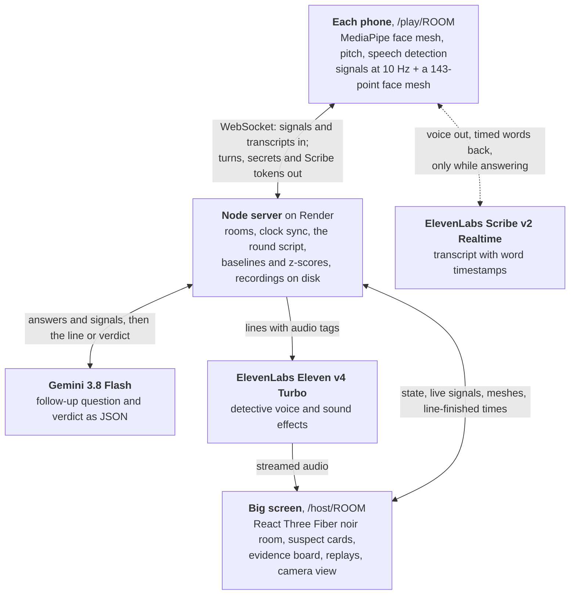

# Deadpan

**One of you is lying. The detective is listening.**

Deadpan is a party bluff game for 2–6 players with an AI detective. Everyone joins on their own phone by scanning a QR code. Each phone watches its player's face and listens to their voice **on the device itself**, and a laptop "big screen" turns the room into a film-noir interrogation: a glowing face mesh for every suspect, their signals pulsing beside them, and a detective who asks questions out loud, grills whoever drifts from their calm, and names the liar with the evidence.

- **Play it:** https://deadpan.ink. Open it on a laptop, create a room, and scan the QR code with your phones.
- **No phones handy?** [Watch a recorded round](https://deadpan.ink/host/JGWG?demo=1&from=home): a real game, played back with its faces, signals and voice.

It's a party game, not a lie detector. It measures effort and nerves, and only the cues psychology supports count toward the verdict.

## How a round plays

1. **Calibration.** The detective asks everyone an easy question ("Your name, and your favourite snack"). That answer sets each player's own calm baseline: how fast they usually start talking, their normal pitch, blink rate and so on.
2. **The deal.** Each phone shows a secret, readable only while you press and hold it.
3. **Questions.** The detective asks each player in turn. The big screen shows the question as subtitles, a timer, the live transcript, and every suspect's signals against their own baseline.
4. **The follow-up.** Gemini reads every answer so far and grills the most suspicious player with a question written on the spot ("Sam. You took three seconds to answer that. What colour is it, usually?").
5. **The verdict.** A drumroll while Gemini decides, the spotlight sweeps and lands, the detective names the culprit and the evidence appears, then the reveal.
6. **The evidence.** An evidence board lays the whole round on one timeline: every question and answer, what was said with the filler words marked, the voice and lip traces, blinks, and each spike against the player's baseline. Any round can be replayed exactly as it happened.

### Two games

- **Imposter.** Everyone gets the secret word except one player, who has to bluff. The detective asks two questions each about the word, then accuses one player. Gemini knows the word, so it judges what you said as well as how you said it.
- **Two Truths and a Lie.** The detective asks everyone three questions about themselves ("Have you ever broken a bone? Tell me how."). Each phone secretly tells its player which answer to lie on. At the end the detective names every player's lie.

## What it reads

| Counts toward the verdict | Shown, but never used |
|---|---|
| **Response time:** from the end of the question to your first word | **Gaze**, labeled **MYTH**: looking away is not a reliable sign of lying ([DePaulo et al., 2003](https://doi.org/10.1037/0033-2909.129.1.74)) |
| **Hesitation:** pauses, filler words ("um", "uh", a comma-set "like", "you know") and slower speech, timed from word timestamps | **Heart rate** from the camera (the POS method on skin colour), with a signal-quality badge. It's decoration: a noisy room makes it unreliable |
| **Pitch:** how far your voice rises above your calm pitch, in semitones | **Head pose and PERCLOS** (eyes-closed time), in the camera view |
| **Blink rate** and **lip press**, against your baseline | |

Every signal is scored as a z-score against **that player's own calibration**, so a fast talker and a slow thinker are judged against themselves, not each other. The delivery score weights response time 0.30, hesitation 0.25, pitch 0.20, blinks 0.15 and lip press 0.10.

### Privacy

Video never leaves the phone. Each phone sends a few dozen numbers ten times a second, plus a reduced face mesh for the big screen (all 478 points only while the camera view is open). Your voice goes to ElevenLabs Scribe for transcription only while you're answering. Rounds are saved on the server so they can be replayed, and anyone with the room code can open that room's past rounds.

### How accurate is it?

In 18 two-player Imposter playtest rounds, the detective named the imposter 13 times (72%), where a coin flip gets 50%. Re-scoring those same rounds after fixing two measurement bugs, Gemini's verdict was right 78% of the time. That's a small, informal sample with mostly the same few players. Two Truths and a Lie is too new to have a number.

## Architecture



- **One process** serves the web app, the API and the WebSocket. There's no database: each finished round is written to `rounds/<ROOM>-<round>.json` with every signal sample, word, line and game event, which is what the evidence board and replays read.
- **Response time needs one clock.** Phones sync to the server NTP-style (the median of five pings), and the big screen reports the moment each question finished playing, in server time.
- **A round always finishes.** Every network call has a timeout. If Gemini is slow, the detective uses a local verdict from the same scores; if ElevenLabs is down, cached lines play, then the laptop's own voice; a phone that drops out keeps its seat for 45 seconds.

### Repository

| Path | What's there |
|---|---|
| `apps/web` | The React app: landing page, phone (`pages/Play.tsx`, `phone/`), big screen (`pages/Host.tsx`, `host/`), admin page |
| `server` | Express 5 and `ws`: rooms (`rooms.ts`), the round script (`game.ts`), scoring (`scoring.ts`), the detective's prompts (`detective.ts`), voice and sound effects (`audio.ts`), recordings (`recorder.ts`) |
| `packages/shared` | Every message type and game constant, plus the face mesh tables |
| `demo/` | The recorded round the landing page plays |
| `SPEC.md`, `KICKOFF.md` | The build spec and the milestone prompts the project was built from |

## Run it yourself

You need Node 22, pnpm 10, a [Gemini API key](https://aistudio.google.com) and an [ElevenLabs](https://elevenlabs.io) API key with a voice ID.

```bash
pnpm install
cp .env.example .env   # then fill in the keys
pnpm dev               # http://localhost:3000
```

Phones need HTTPS for the camera and can't reach `localhost`, so open a tunnel and use its link on the laptop:

```bash
cloudflared tunnel --url http://localhost:3000
```

Open `https://<tunnel>/host/ABCD` on the laptop and scan the QR code with your phones. A round starts with as few as one phone, which is handy for testing.

| Variable | What it's for |
|---|---|
| `GEMINI_API_KEY` | The detective's follow-up questions and verdicts |
| `ELEVENLABS_API_KEY`, `ELEVENLABS_VOICE_ID` | The detective's voice, live transcription and sound effects |
| `ADMIN_KEY` | Opens `/admin`: every saved round and the accuracy stat |
| `ROUNDS_DIR` | Where recordings go (default `rounds/`) |

Other commands: `pnpm typecheck`, `pnpm build`, and `pnpm start` to run the production build. `render.yaml` deploys the whole thing to [Render](https://render.com) as one web service with a 1 GB disk for recordings.

The first start generates the detective's canned lines and sound effects with ElevenLabs and caches them in `server/audio-cache/`.

## Sponsor tech

- **ElevenLabs**
  - **Eleven v4 Turbo** with inline audio tags (`[low, gravelly]`, `[whispers]`, `[pause]`) is the detective's voice. Gemini's lines stream to the big screen as they're generated.
  - **Scribe v2 Realtime** transcribes each answer from the phone, using a single-use token. Its word timestamps are part of the sensing: they time every pause and filler.
  - **Sound effects:** the drumroll, the stinger, the noir room tone and the "case closed" stamp.
- **Gemini** (`gemini-3.8-flash`, thinking low, structured JSON output) is the detective's brain. It writes the follow-up from everyone's transcripts and signals, then names the imposter or every player's lie, with evidence lines and a confidence.
- **Computer vision** (for the Mercedes challenge). All sensing runs on the phone:
  - MediaPipe's 478-point face mesh at about 15 fps on the GPU;
  - blink detection from the eye aspect ratio, lip press from blendshapes, head pose from the face transform;
  - a camera-based pulse;
  - a **camera view** on the big screen showing exactly what each phone sees. The same on-device pipeline could watch a driver for drowsiness without any video leaving the car.

## Built with

TypeScript, React 19, Vite, React Three Fiber, drei and postprocessing (three.js), MediaPipe Tasks Vision 1.0.1, pitchy, vad-web (Silero VAD) with ONNX Runtime Web, Node.js, Express 5, ws, tsx, the Google Gen AI SDK, the ElevenLabs API, qrcode, Instrument Sans and Instrument Serif (via Fontsource), Render and Cloudflare Tunnel.

## Built at Hacklanta 2026, and the AI tools used

- **Code:** all of it was written during the hackathon. Before that there was only the plan.
- **Writing the code:** Claude Code (Anthropic's AI coding agent) wrote the code, one milestone at a time from [SPEC.md](SPEC.md) and [KICKOFF.md](KICKOFF.md). Every milestone was tested by hand on a real iPhone and laptop before it was committed. The tuning, the playtests and the game design decisions came from playing it.
- **Planning and design:** the plan and the build spec were drafted with Claude before coding started. The visual redesign started from mockups made with Claude Design.
- **In the game:** Gemini and ElevenLabs are the AI the detective runs on, as described above.
- **Other people's work:** the open-source libraries listed above, and Google's MediaPipe face landmarker model.

## Known limitations

- Android hasn't been tested on a real phone yet; every playtest used iPhones.
- The camera pulse has never been checked against a reference, which is why it's never used as evidence.
- Bluetooth headsets switch the mic to call quality, which throws pitch readings off. Phones that detect one ask the player to take it out.
- Anyone who knows a room's 4-letter code can open its past rounds.
